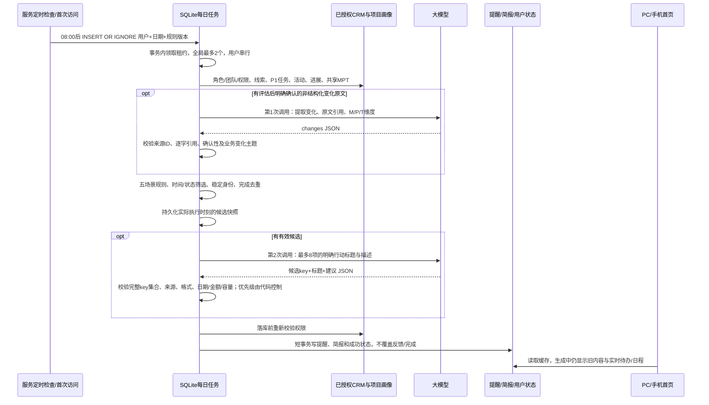

# 小Cue v2：角色场景与本地验收

2026-11-24。本次仅更新本地系统，演示数据留在忽略的runtime数据库，不发布用户数据。

## 组织与数据边界

- SPP是销售业务团队，成员岗位为S（销售）、PM（项目经理）、PD（解决方案工程师）。`spp_teams`记录团队、区域、Leader和成员岗位，`spp_regions`记录区域总裁与所属区域。
- 商机记录`primarySalesId / primaryPmId / primaryPdId / sppTeamId`，原`ownerId`继续作为兼容的销售负责人。没有明确团队时，只在主责销售唯一归属某团队时推断；不得把客户联系人当成内部成员。
- SPP Leader汇总其管理团队；区域总裁汇总其区域下多个SPP；系统管理员不会因管理员权限自动收到团队经营提醒。PM/PD没有新增个人提醒场景。
- 团队范围还要与CRM权限相交。共享项目画像只取身份、业务背景、MPT和S1–S4；销售提醒可引用本人有效私有画像，管理汇总不读下属私有画像。
- 团队提醒、详情、派生会话、运行记录、历史列表和对话日志均复核管理范围。团队调换或撤权后，原汇总内容不继续返回。

## 第一版规则

| 角色 | 场景 | 首版触发条件 | 依据 |
|---|---|---|---|
| 销售 | 新线索尚未首次联系 | 分配超过24小时，仍有效，无确认联系进展或实际发生的联系活动 | 线索分配时间、主责人、联系进展、商务活动 |
| 销售 | 关键任务逾期 | 本人P1待办未完成，截止时间已过 | 任务、关联客户/线索/商机 |
| 销售 | 重要沟通准备缺口 | 未来24小时重要活动，有明确关联的未完成准备任务 | 活动的`important / preparationTaskIds`、任务 |
| 销售 | 商务活动结果待确认 | 计划时间已过24小时，未取消，无已确认结果及关联进展/会晤结果 | 活动、`activityId`关联进展及会晤记录；未确认发生时先核实是否举行 |
| 销售 | 关键变化后复核MPT | 已评估的S1–S4商机，在共享评估更新时间之后有已确认的M/P/T实质变化 | 共享MPT版本、商机进展中的确认变化；不自动修改MPT |
| SPP Leader | S级客户缺少跟进 | 近7天无有效商务活动、线索或商机进展 | 团队销售负责的S级客户及CRM记录 |
| SPP Leader | 重点商机无明确推进安排 | 无未完成且明确执行人/截止日的任务，也无完整下一步计划 | 重点商机、任务、`nextAction` |
| SPP Leader | 重点商机重大变化 | 最近7天明确确认的重大变化 | 重点商机与进展 |
| SPP Leader | 评审/投标需介入 | 明确开放的管理介入请求，所需时间在未来7天 | CRM实体上的`managementRequest`及关联商机 |
| SPP Leader | 销售推进记录覆盖差异 | 近28天没有有效记录，或有记录的日期/工作日低于团队平均，至少2名销售 | 本团队销售编写的有效进展、完成活动；PM/PD不参与销售比较 |
| 区域总裁 | S级客户覆盖缺口 | 按所管SPP分别汇总上述客户缺口 | 各SPP共享CRM数据 |
| 区域总裁 | 持续缺少推进安排 | 已观察到重点商机缺口持续7天以上 | 每日持久化缺口观察、商机及任务；不自动升级 |
| 区域总裁 | 重大经营变化 | 所管SPP重点商机重大变化 | 已确认的CRM变化 |
| 区域总裁 | 跨团队资源/决策协调 | 未来7天明确区域协调请求 | `managementRequest.requiresRegionalCoordination=true` |
| 区域总裁 | 持续记录覆盖差异 | 本28天及前28天窗口均低于所在团队平均 | 两窗口实际进展/完成活动 |

频率结果只是“核实记录与分工”的线索，不等于工作投入或绩效判断。当前没有真实考勤、休假、节假日和完整项目工作量数据；首版工作日按周一到周五计算，不假装已做考勤/工作量校准。上级应先核实分工、在岗及记录完整性。后续有真实数据后再引入更精确的可比口径。

## 每日生成与模型交互

北京时间08:00后，每用户每日一份任务。服务15秒轮询检查是否到期；日首次访问也只补建同一任务。不提供手动刷新、强制生成、重大事件增量更新或逐级升级。

结构化确认变化可直接进入规则，不必调用第一阶段。无候选不调用模型，生成真实空结果。每批先兼顾不同场景，再按规则优先级补足8项；不足不凑数。提醒标题写具体对象和行动，不使用“补齐阶段未决项清单”。

任务、租约、尝试次数、下一重试时刻、候选快照存于SQLite documents中的`workbench_jobs / workbench_snapshots`。失败后1、5、15分钟重试，共4次；租约3分钟，重启后到期接管，第四次中断也会收敛到失败。失败保留有效旧结果，不伪装“没有提醒”。已完成任务当天不重跑；新事实次日处理。

提醒业务身份独立于模型措辞，用户状态单独保存在`cue_states`；失效提醒归档而非删除，已完成v2记录仍可查看。AI提醒完成不关闭CRM任务。

销售单项目提醒进入原关联会话；团队汇总进入无单一商机绑定的普通会话，携带已授权来源，连续启动复用同次结果。自动委托标记AI/系统来源，不进入用户事实画像采集。

## 本地演示数据

手动执行`npx tsx scripts/seed-cue-scenarios.ts`，会先对当前数据库做SQLite一致性备份，再添加`CUE-DEMO-YYYY-MM-DD`命名空间；所有记录带`fictional / demoDataset`，同日重跑不覆盖用户编辑。不会自动向生产初始化流程加入演示数据。

- 张小小（U-018）：五类销售场景；关西工厂待提交方案/交付边界、负荷曲线准备、采购沟通结果、海港线索首次联系、东港/南湖MPT复核。
- 王经理（U-020）：华北SPP Leader。
- `[演示] 华东SPP Leader`（U-CUE-LEADER-B）：华东团队。
- `[演示] 区域总裁`（U-CUE-PRESIDENT）：华北及华东两个SPP，含投标授权及并网专家协调。
- 同时有已联系线索、已完成任务、没有明确准备缺口的活动等反例。

首次已在本地增量写入66条CRM记录；备份位于`runtime/app/backups/`。个人会话、记忆和已有CRM记录均未重置。初始原有任务仍可能产生符合新规则的逾期提醒，不会为演示隐藏真实现有数据。

## 验证记录

实现分支`codex/cue-role-scenarios`，基于develop并保留尚未合并的本地界面/原型基线。`npm test` 214项、`npm run test:ci` 204项及`npm run build`通过；Chrome下12条浏览器旅程覆盖PC/手机、管理角色、反馈完成、来源、任务日报、日程、会话及MPT/画像回归。真实本地模型已为销售、SPP Leader、区域总裁生成可追溯提醒，未使用测试回放冒充在线结果。两阶段模型HTTP路径另有受控适配测试。

云端部署、组织后台维护页面、外部邮箱/日历、真实考勤接入、事件增量生成和自动升级不在本轮范围。
